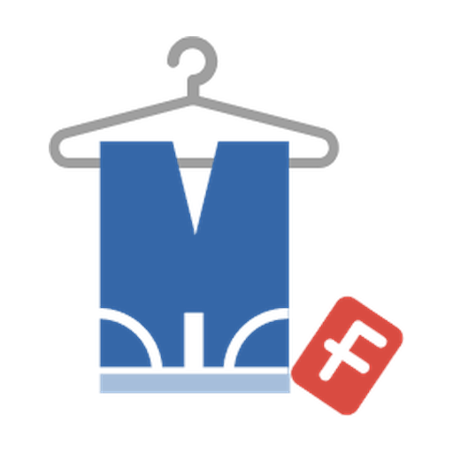

# My Flohmarkt

Find flea markets, yard sales, children's markets and antique markets in Germany
from a conversation with Claude. Search the public [My Flohmarkt](https://my-flohmarkt.de/)
catalogue by city, postal code, date range or radius, read the details of a market,
or discover recently added and updated listings. Event content is mainly German.

Published by **Krola Consulting GmbH**. No My Flohmarkt account or API key is
required for the public catalogue connection.

This repository contains the Claude plugin bundle. Public MCP server documentation
and registry metadata are maintained separately in
[my-flohmarkt/mcp](https://github.com/my-flohmarkt/mcp).

## Connect and use

1. Add this plugin to Claude. For a personal test, use **Customize → Plugins →
   Add → Upload plugin** and select the installation ZIP.
2. Open the plugin's **Connectors** tab and add or connect **My Flohmarkt**.
   The server URL is `https://mcp.my-flohmarkt.de/mcp`; authentication is **none**.
3. Open a conversation and ask for markets. On Team and Enterprise, an Owner
   first makes the connector available to the organization.

Examples:

- **„Finde Flohmärkte dieses Wochenende in Nürnberg mit Datum, Uhrzeit und Link.“**
- **„Welche Kinderflohmärkte sind in der Postleitzahl 90425 gelistet?“**
- **„Zeige die fünf zuletzt hinzugefügten oder aktualisierten Flohmärkte.“**
- **„Zeige für den ersten Treffer Adresse, Öffnungszeiten und bekannte Gebühren.“**

For a radius search, provide the centre coordinates and radius, for example
**„Suche Flohmärkte im Umkreis von 25 km um den Münchner Marienplatz
(48.1372, 11.5756).“** The plugin does not obtain your device's GPS position.

In Claude Code, run `claude --plugin-dir .` from this plugin's folder.
The skill is available as `/my-flohmarkt:flohmarkt-suche`; `/mcp` shows the
connection. In chat and Cowork, the remote connector must be connected from
the plugin's Connectors tab.

## What the connection provides

| Tool                      | Purpose                                                       |
| ------------------------- | ------------------------------------------------------------- |
| `search_events`           | Search the catalogue by text, city/PLZ, dates or coordinates. |
| `get_event`               | Read one returned market's public details by its UUID.        |
| `recently_updated_events` | List markets by their most recent catalogue change.           |

Results link to their pages on my-flohmarkt.de. Searches show at most 50 items;
use narrower filters when there are more matches. Missing opening times or fees
remain unknown. An unknown entrance fee does not mean free admission.

The catalogue is refreshed periodically. Listings can be incomplete, and changes
or cancellations may not appear immediately. Check the event page and organizer's
information before travelling. A catalogue update does not mean the organizer
recently confirmed an event.

This version searches and reads public listings. It cannot reserve or pay for
stands, register sellers, publish events, read private messages or change accounts.
Use the website and the relevant organizer for those activities.

## Privacy and support

Tool calls send the search parameters or public event ID needed for the requested
lookup to the My Flohmarkt server, and return the public results to Claude. The
tools do not request conversation history, user files or private account data.
The service processes technical access information for operation and security;
it does not require a My Flohmarkt login for these tools.

- [Connection documentation](https://my-flohmarkt.de/mcp.md)
- [Privacy policy](https://my-flohmarkt.de/datenschutz)
- [Terms of service](https://my-flohmarkt.de/agb)
- [Publisher and contact](https://my-flohmarkt.de/impressum)
- Support and security reports: [info@my-flohmarkt.de](mailto:info@my-flohmarkt.de)
- Privacy enquiries: [datenschutz@my-flohmarkt.de](mailto:datenschutz@my-flohmarkt.de)

Claude's handling of conversations is governed by Anthropic's own terms and
privacy information.

## License

This plugin is proprietary. See [LICENSE](LICENSE). Installation and use of the
unmodified plugin with My Flohmarkt are permitted. Reuse for other products,
modified distributions and competing listings require the publisher's written
permission, subject to mandatory law and applicable hosting-platform rights.
The My Flohmarkt name and logo remain reserved to their rights holder.
